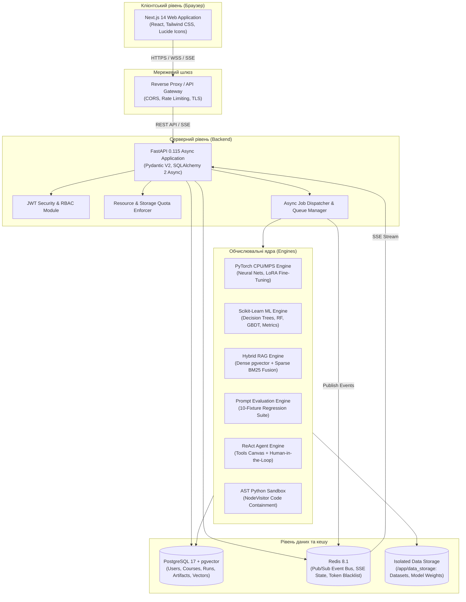
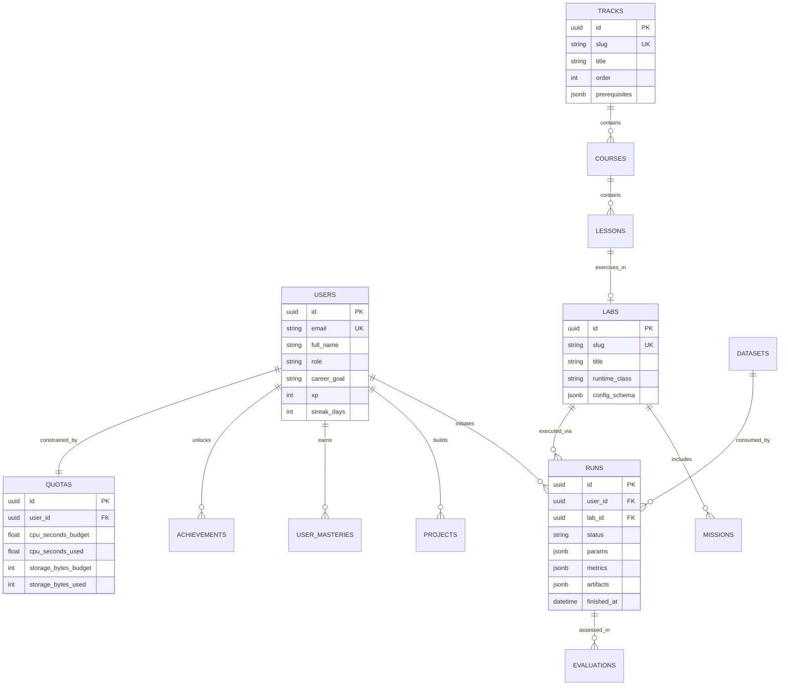
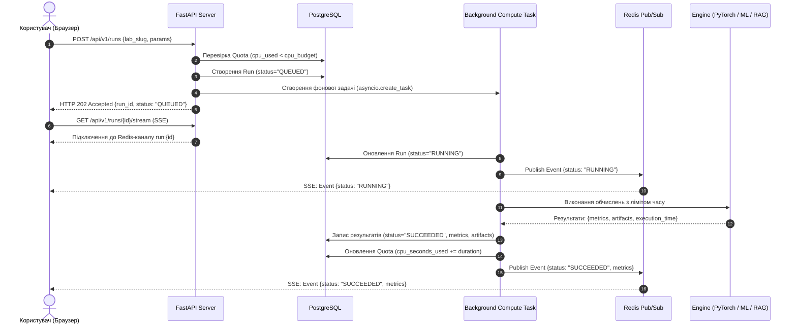

# АРХІТЕКТУРА СИСТЕМИ
## AI Engineering Academy — System Architecture & Design Specification

### 1. Загальний огляд (System Overview)

Платформа **AI Engineering Academy** побудована як повнофункціональна інтерактивна система для глибокого навчання інженерів штучного інтелекту без використання сторонніх платних API. Усі обчислення, навчання моделей, оцінювання якості промптів, RAG-пошук та виконання агентських ланцюжків здійснюються локально за допомогою відкритого стеку інструментів (PyTorch, scikit-learn, pgvector, transformers, NetworkX, SciPy).

---

### 2. Діаграма C4 Container (Контейнерний рівень)

---

### 3. Модель даних (Entity Relationship Model)

---

### 4. Політика безпеки та ізоляція коду (Security & Sandboxing)

1. **Пісочниця виконання Python (AST Sandbox):**
   - Увесь код, що надсилається користувачем для перевірки в завданнях програмування або аналізу даних, парситься за допомогою модуля `ast`.
   - Заборонені вузли AST: `ast.Import`, `ast.ImportFrom`.
   - Заборонені імена та атрибути: будь-які імена або властивості з префіксом `_` (блокування доступу до `__class__`, `__subclasses__`, `__bases__`, `__globals__`).
   - Заборонені вбудовані функції: `open`, `eval`, `exec`, `globals`, `locals`, `getattr`, `setattr`, `compile`.
   - Перехоплення стандартного виводу виконується потокобезпечно через `contextlib.redirect_stdout` в ізольованому контексті виклику.

2. **Захист від вичерпання ресурсів (Resource Quotas & Timeouts):**
   - Кожен користувач має ліміт на час процесора (`cpu_seconds_budget`, стандартно 1200 секунд для вільного рівня).
   - Ліміт пам'яті для збереження датасетів та моделей (`storage_bytes_budget`, стандартно 500 МБ).
   - Жорсткий таймаут виконання будь-якого одиночного запуску лабораторії (`max_duration_sec`, від 30 до 180 секунд).

3. **Мережева ізоляція та секрети:**
   - Сервіси бази даних (PostgreSQL) та брокера повідомлень (Redis) зв'язуються виключно з адресою `127.0.0.1` або працюють всередині ізольованої віртуальної мережі Docker без зовнішніх відкритих портів.
   - Секрети читаються виключно зі змінних середовища або Docker Secrets, не зберігаючись у репозиторії.

---

### 5. Життєвий цикл асинхронного запуску (Execution Lifecycle)

