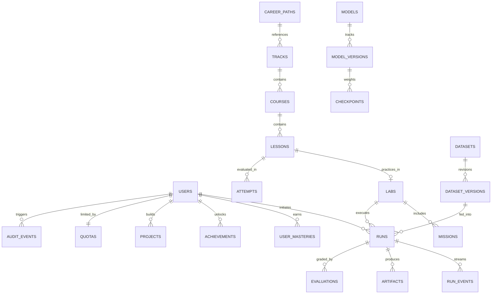

# МОДЕЛЬ ДАНИХ ТА СХЕМА СУТНОСТЕЙ (DATA MODEL)
## AI Engineering Academy — Relational & Vector Data Specifications

**Версія:** 2.0 | 30 жовтня 2026  
**СУБД:** PostgreSQL 17 з розширенням `pgvector` 0.8.2 + Redis 8.1.0  
**ORM:** SQLAlchemy 2.0 (Async Engine + asyncpg)  

---

### 1. Каталог сутностей системи (22 обов'язкові сутності)

---

### 2. Специфікація таблиць

#### 2.1. Користувачі та безпека
- **`users`**:
  - `id`: UUID (Primary Key)
  - `email`: VARCHAR(255) UNIQUE NOT NULL
  - `password_hash`: VARCHAR(255) NOT NULL
  - `full_name`: VARCHAR(255) NOT NULL
  - `role`: user_role (ENUM: guest, learner, mentor, content_author, ml_operator, platform_admin, service_worker)
  - `locale`: VARCHAR(10) DEFAULT 'uk'
  - `xp`: INTEGER DEFAULT 0
  - `streak_days`: INTEGER DEFAULT 0
  - `created_at`, `updated_at`: TIMESTAMP WITH TIME ZONE

- **`resource_quotas`**:
  - `id`: UUID (Primary Key)
  - `user_id`: UUID FOREIGN KEY `users.id` ON DELETE CASCADE
  - `cpu_seconds_budget`: FLOAT DEFAULT 1200.0 (20 хвилин CPU на добу)
  - `cpu_seconds_used`: FLOAT DEFAULT 0.0
  - `storage_bytes_budget`: BIGINT DEFAULT 524288000 (500 MB)
  - `storage_bytes_used`: BIGINT DEFAULT 0
  - `last_reset_at`: TIMESTAMP WITH TIME ZONE

- **`audit_events`**:
  - `id`: UUID (Primary Key)
  - `actor_id`: UUID FOREIGN KEY `users.id`
  - `action`: VARCHAR(100) NOT NULL (e.g., "sandbox_exec", "file_upload", "lora_train")
  - `resource_id`: VARCHAR(100)
  - `ip_address`: VARCHAR(45)
  - `status`: VARCHAR(50) (SUCCESS, DENIED, ERROR)
  - `details`: JSONB
  - `created_at`: TIMESTAMP WITH TIME ZONE

#### 2.2. Кар'єрні шляхи та Навчальний контент
- **`career_paths`**:
  - `slug`: VARCHAR(100) PRIMARY KEY (ai-engineer, ml-engineer, llm-engineer, etc.)
  - `title`: VARCHAR(255) NOT NULL
  - `tagline`: TEXT NOT NULL
  - `description`: TEXT NOT NULL
  - `role_focus`: VARCHAR(100)
  - `estimated_hours`: INTEGER
  - `track_slugs`: JSONB (Ordered list of track slugs)
  - `milestones`: JSONB

- **`tracks`**:
  - `id`: UUID (Primary Key)
  - `slug`: VARCHAR(100) UNIQUE NOT NULL
  - `title`: VARCHAR(255) NOT NULL
  - `description`: TEXT
  - `order`: INTEGER DEFAULT 0
  - `prerequisites`: JSONB DEFAULT '[]'
  - `outcomes`: JSONB DEFAULT '[]'
  - `status`: VARCHAR(50) DEFAULT 'published'

- **`courses`**:
  - `id`: UUID (Primary Key)
  - `track_id`: UUID FOREIGN KEY `tracks.id` ON DELETE CASCADE
  - `slug`: VARCHAR(100) UNIQUE NOT NULL
  - `title`: VARCHAR(255) NOT NULL
  - `level`: VARCHAR(50) DEFAULT 'intermediate'
  - `order`: INTEGER DEFAULT 0

- **`lessons`**:
  - `id`: UUID (Primary Key)
  - `course_id`: UUID FOREIGN KEY `courses.id` ON DELETE CASCADE
  - `lab_id`: UUID FOREIGN KEY `labs.id` ON DELETE SET NULL
  - `slug`: VARCHAR(100) NOT NULL
  - `title`: VARCHAR(255) NOT NULL
  - `content_md`: TEXT NOT NULL
  - `theory_summary`: TEXT
  - `visual_algorithm_md`: TEXT
  - `quiz_questions`: JSONB DEFAULT '[]'

#### 2.3. Лабораторії, Експерименти та Обчислення
- **`labs`**:
  - `id`: UUID (Primary Key)
  - `slug`: VARCHAR(100) UNIQUE NOT NULL
  - `title`: VARCHAR(255) NOT NULL
  - `runtime_class`: runtime_class (browser_wasm, cpu_worker, gpu_worker)
  - `cost_weight`: FLOAT DEFAULT 1.0
  - `max_duration_sec`: INTEGER DEFAULT 120
  - `config_schema`: JSONB DEFAULT '{}'
  - `default_config`: JSONB DEFAULT '{}'

- **`runs`**:
  - `id`: UUID (Primary Key)
  - `user_id`: UUID FOREIGN KEY `users.id` ON DELETE CASCADE
  - `lab_id`: UUID FOREIGN KEY `labs.id` ON DELETE CASCADE
  - `execution_mode`: VARCHAR(50) DEFAULT 'cpu-real'
  - `params`: JSONB DEFAULT '{}'
  - `status`: VARCHAR(50) (queued, running, succeeded, failed, cancelled)
  - `metrics`: JSONB DEFAULT '{}'
  - `artifacts`: JSONB DEFAULT '{}'
  - `resource_usage`: JSONB DEFAULT '{}'
  - `error_code`: VARCHAR(50)
  - `error_message`: TEXT
  - `trace_id`: VARCHAR(100) NOT NULL
  - `idempotency_key`: VARCHAR(100)
  - `started_at`, `finished_at`: TIMESTAMP WITH TIME ZONE

- **`vector_documents` (pgvector)**:
  - `id`: UUID (Primary Key)
  - `collection_name`: VARCHAR(100) INDEX
  - `document_name`: VARCHAR(255) NOT NULL
  - `chunk_index`: INTEGER NOT NULL
  - `text`: TEXT NOT NULL
  - `embedding`: VECTOR(384) NOT NULL
  - `metadata_json`: JSONB DEFAULT '{}'
  - `created_at`: TIMESTAMP WITH TIME ZONE

- **`projects` (Портфоліо робіт)**:
  - `id`: UUID (Primary Key)
  - `owner_id`: UUID FOREIGN KEY `users.id` ON DELETE CASCADE
  - `title`: VARCHAR(255) NOT NULL
  - `description`: TEXT
  - `visibility`: VARCHAR(50) DEFAULT 'private' (public, private)
  - `repo_url`: VARCHAR(500)
  - `architecture_md`: TEXT
  - `metrics`: JSONB DEFAULT '{}'
  - `configs`: JSONB DEFAULT '{}'
  - `commit_hash`: VARCHAR(40)
  - `created_at`, `updated_at`: TIMESTAMP WITH TIME ZONE
