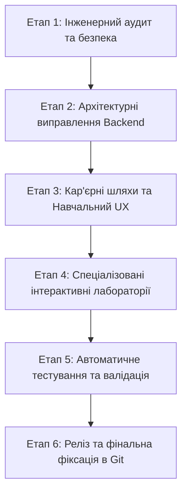

# ПЛАН ВПРОВАДЖЕННЯ ТА РОЗРОБКИ
## AI Engineering Academy — Full Platform Implementation Roadmap

### 1. Стратегічна мета
Створити інтерактивну інженерну навчальну платформу нового покоління, яка поєднує:
- Інтерактивність і покрокову перевірку (рівень Codecademy)
- Гейміфікацію, стріки та систему навичок (рівень Duolingo)
- Справжні обчислювальні ядра, датасети та метрики (рівень Hugging Face)
- Організацію коду, проектів та портфоліо (рівень GitHub)

---

### 2. Етапи реалізації

#### Етап 1: Інженерний аудит та безпека (Завершено)
1. **SEC-01**: Видалення статичних паролів та секретів з `docker-compose.yml`. Створення `.env.example` та безпечна конфігурація.
2. **SEC-02**: Обмеження публікації портів PostgreSQL та Redis виключно до локального хоста `127.0.0.1` або ізольованої Docker-мережі.
3. **SEC-03**: Повна перебудова пісочниці виконання коду на базі `ast.NodeVisitor` для запобігання витоку пам'яті, доступу до dunder-атрибутів та підміни `sys.stdout`.
4. **SEC-04**: Валідація прав доступу (IDOR) на проекти, датасети та артефакти користувачів.
5. **API-01**: Коригування `NEXT_PUBLIC_API_URL` для коректної роботи браузерного клієнта.

#### Етап 2: Архітектурні виправлення Backend та фонові воркери
1. **OPS-01**: Асинхронний диспетчер обчислень. Запити на запуск повертають `202 Accepted` з `run_id`, а виконання відбувається у фонових воркерах з публікацією подій через Redis Pub/Sub та збереженням у PostgreSQL.
2. **OPS-02**: Скрипти резервного копіювання (`scripts/backup_db.sh`) та відновлення (`scripts/restore_db.sh`) бази даних та pgvector індексів.
3. **OPS-03**: Контроль лімітів дисків та обчислювальних квот користувачів у реальному часі.
4. **Career Paths API**: Створення сутностей та ендпоінтів для кар'єрних треків:
   - AI Engineer
   - ML Engineer
   - LLM Engineer
   - Research Engineer
   - AI Integrator
   - MLOps Engineer

#### Етап 3: Кар'єрний та навчальний UX
1. **Онбординг користувача (`/onboarding`)**:
   - Інтерактивний вибір кар'єрної мети
   - Вхідне діагностичне тестування рівня знань
   - Генерація персонального графа навичок
   - Рекомендація стартового практичного завдання
2. **Кар'єрний навігатор (`/career-paths`)**:
   - Візуалізація передумов та етапів розвитку
   - Вільний доступ до будь-якої теми без штучного блокування досвідчених інженерів
   - Відстеження прогресу за шкалою майстерності (Beginner → Proficient → Master)

#### Етап 4: Спеціалізовані інтерактивні лабораторії
Перехід від загальних текстових конфігурацій до спеціалізованих інтерфейсів:
1. **Mathematics for AI**:
   - Інтерактивний 2D/3D візуалізатор градієнтного спуску
   - Конструктор матричних операцій та власних векторів
2. **Data Engineering & Cleaning**:
   - Табличний переглядач із профайлером колонок
   - Інтерактивне усунення пропущених значень та викидів
   - Валідатор витоку даних (Data Leakage Auditor)
3. **Classical Machine Learning**:
   - Вибір алгоритму (Linear/Logistic, Tree, Random Forest, GBDT, SVM, KNN)
   - Інтерактивна теплова карта матриці плутанини (Confusion Matrix)
   - Слайдер порогу чутливості ROC-AUC та графік кривих навчання
4. **Deep Learning Playground**:
   - Візуальний конструктор шарів нейромережі (Linear, Conv2D, Dropout, Activations)
   - Реальний цикл навчання PyTorch на CPU/MPS з живими графіками Train/Val Loss
5. **Prompt Engineering Studio**:
   - Багатопромптовий редактор із системними та користувацькими змінними `{{variable}}`
   - Конструктор схем JSON Schema з гарантованим structured output
   - Батарея з 10 тест-кейсів для автоматичного регресійного оцінювання якості
6. **RAG Pipeline Architect**:
   - Налаштування чанкінгу (розмір чанка, перекриття)
   - Візуалізація векторного простору embeddings
   - Порівняння гібридного пошуку Dense vs Sparse (BM25)
   - Інспектор цитувань та оцінка обґрунтованості (Groundedness Score)
7. **Fine-Tuning Workbench**:
   - Інтерактивні повзунки параметрів LoRA (Rank `r`, Alpha `alpha`, Dropout, Target Modules)
   - Моніторинг кроків градієнтного спуску та графік Perplexity
   - Порівняння виводу моделі "До" та "Після" Fine-Tuning
8. **Autonomous AI Agents**:
   - Конструктор доступних інструментів (CRM, Calendar, Mailbox, Python, Calculator)
   - Покроковий трейс ReAct (Thought -> Action -> Observation -> Final Answer)
   - Модальне вікно Human-in-the-Loop для підтвердження критичних дій
9. **Workflow Automation**:
   - Візуальний канвас DAG для з'єднання тригерів, HTTP вебхуків, трансформацій та обробки помилок
10. **MLOps & Monitoring**:
    - Детектор дрейфу даних (Data & Concept Drift) на основі тесту Колмогорова-Смірнова
    - Монітор латентності, квот та версій моделей у реєстрі

#### Етап 5: Комплексне тестування та перевірка якості
1. Модульні тести обчислювальних ядер (`pytest backend/tests/test_engines.py`)
2. Інтеграційні тести API (`pytest backend/tests/test_api.py`)
3. Тести безпеки пісочниці та квот (`pytest backend/tests/test_security.py`)
4. Збірка та валідація TypeScript компонентів frontend (`pnpm build`)
5. Складання фінального звіту `TEST_REPORT.md`

#### Етап 6: Фіксація та публікація
1. Перевірка відсутності незафіксованих змін у git
2. Пуш оновленої системи до віддаленого репозиторію `https://github.com/synthetix-dev/AI-Engineering-Academy.git`
