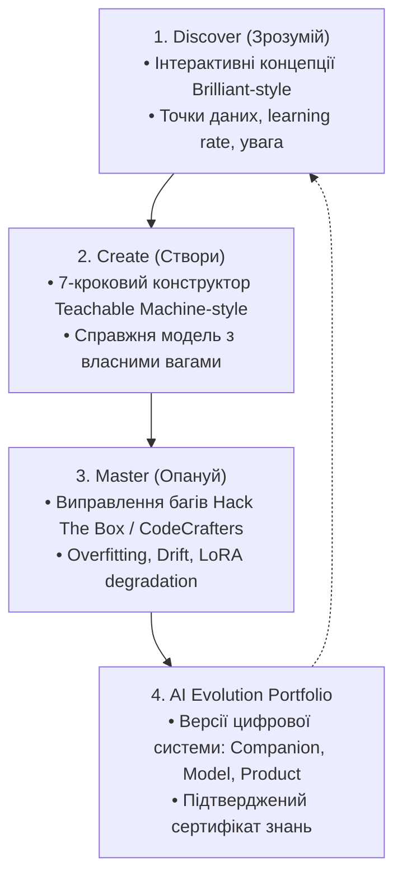

# AI Engineering Academy 2.0 🎓⚡️
### Інтерактивна open-source вебплатформа для підготовки AI Engineers від базових принципів до Production

[](https://opensource.org/licenses/MIT)
[](https://www.python.org/downloads/)
[](https://nextjs.org/)
[](docs/TEST_REPORT.md)
[](docs/CURRICULUM.md)

---

## 💡 Про Проєкт

**AI Engineering Academy 2.0** — це безкоштовна інтерактивна навчальна платформа українською мовою, створена для якісної практичної підготовки AI Engineers нового покоління.

На відміну від класичних відеокурсів або простих каталогів завдань, навчання в Академії побудоване навколо створення, дослідження та вдосконалення **справжніх діючих AI-систем** безпосередньо у веб-браузері.

### Ключові принципи платформи:
1. **Жодних обов'язкових платних API або закритих SaaS**: Всі обчислення, інференс та навчання моделей виконуються на клієнті (WebAssembly / Pyodide / WebGPU / TFJS) або на власному відкритому бекенді (FastAPI / PyTorch / Scikit-Learn).
2. **Нульовий поріг входу без примусового програмування на старті**: Людина без попереднього бекграунду в програмуванні починає з візуальних інтерактивних експериментів та поступово заглиблюється в код, алгоритми та інженерію систем.
3. **«Подивитися, як це працює»**: Будь-який візуальний елемент або експеримент містить висувну панель інспекції з 7 вичерпними інженерними пунктами: алгоритмічне пояснення, версія бібліотеки, точний конфіг, виконуваний код на Python, приклад I/O, cURL-запит до API та автономний скрипт для локального відтворення.
4. **Концепція Zero-Mock**: Усі 20 навчальних треків використовують справжні математичні та чисельні розрахунки (NumPy SIMD, зворотне поширення помилки в PyTorch, матриці уваги Softmax, реальне LoRA fine-tuning, виклики інструментів агентами ReAct). Жодних фіктивних значень чи статичних заглушок!

---

## 🔄 Навчальний Трикутник (Learning Core)

Платформа побудована на синергії трьох взаємопов'язаних механік:



- **Discover (Зрозумій)**: Короткі інтерактивні пояснення. Користувач пересуває точки, змінює температуру генерації, налаштовує розмір кроку градієнтного спуску і бачить миттєву зміну ландшафту втрат.
- **Create (Створи)**: Природний 7-кроковий процес побудови власного AI: *Задача → Дані → Модель → Навчання → Тестування → Аналіз → Збереження*.
- **Master (Опануй)**: Реальні інженерні виклики: «Модель перенавчилася на валідації», «RAG вибирає нерелевантні чанки», «З'явився витік даних (data leakage)». Користувач досліджує та виправляє помилку, а система автоматично верифікує результат на тестовому сеті.

---

## 🧬 Механіка AI Evolution

Користувач не просто проходить уроки, а вирощує власні цифрові артефакти:
- **AI Companion**: Автономний помічник (інструкції, пам'ять, RAG, інструменти ReAct, захист від ін'єкцій).
- **AI Model**: Спеціалізована ML/DL модель (класифікатор, регресор, нейромережа, LoRA-адаптер).
- **AI Product**: Готове продакшн-рішення (вебхуки, черги, моніторинг дрейфу, квантизація INT8).

---

## 🗺️ 20 Навчальних Треків

| Категорія | Треки | Технології |
|---|---|---|
| **Основи та Дані** | 01. AI Foundation & Математика<br>02. Data Engineering & Очищення<br>03. Classical ML & Класифікація<br>04. Optimization & Градієнтний спуск | NumPy SIMD, Pandas, Scikit-Learn, IQR, Momentum |
| **Нейромережі та Моделі** | 05. Deep Learning & Нейромережі<br>06. NLP & Векторні ембеддінги<br>07. Computer Vision & Згортки<br>08. Attention & Архітектура Transformers | PyTorch MLP, ReLU, TF-IDF, Cosine, 2D Sobel, Multi-Head Attention |
| **LLM та Генеративний AI** | 09. LLM Architecture & Інференс<br>10. Prompt Engineering & Формати<br>11. RAG & Векторний пошук<br>12. Training & LoRA Fine-Tuning | KV-Cache, Pydantic Structured Outputs, Chunking, LoRA adapters |
| **Агенти та Мультимодальність**| 13. AI Agents & Виклики інструментів<br>14. Multimodal AI & Звук/Зображення<br>15. Інтеграція систем & Вебхуки | ReAct Reasoning Loop, Late Fusion, Idempotent Webhooks |
| **Продакшн та Інженерія** | 16. Оцінювання, Evals & Метрики<br>17. MLOps, Дрейф даних & Моніторинг<br>18. AI Safety, Red Teaming & Захист<br>19. Оптимізація моделей & Квантизація<br>20. Capstone: Production AI Портфоліо | Precision/Recall/F1, Kolmogorov-Smirnov Test, Prompt Injection Guard, INT8 Post-Training Quantization, Welch t-test |

---

## 🛠️ Архітектура та Технологічний Стек

```
ai-engineering-academy-v2/
├── apps/
│   ├── web/                    # Next.js 14 App Router, Tailwind CSS, Lucide
│   └── api/                    # FastAPI, Pydantic v2, SQLAlchemy 2.0 (Async)
├── packages/
│   ├── design-tokens/          # Палітра кольорів, типографіка Onest/Manrope
│   ├── shared-types/           # Спільні TypeScript контракти домену
│   ├── learning-engine/        # Каталоги треків, кар'єрні шляхи, оцінювачі
│   ├── visualizations/         # Інтерактивні Canvas/SVG віджети (Brilliant-style)
│   └── browser-ml/             # Клієнтський інференс та навчання (Wasm, Pyodide, TFJS)
├── content/                    # Структуровані навчальні матеріали у JSON
├── datasets/                   # Маніфести відкритих навчальних датасетів
├── infrastructure/             # Docker Compose, Nginx, міграції
├── tests/                      # 30 автоматизованих тестів (Unit, Integration, ML, Security)
└── docs/                       # Повний комплект технічної документації
```

- **Frontend**: Next.js 14, React 18, Tailwind CSS, Canvas API, Lucide React Icons.
- **Backend**: Python 3.11+, FastAPI, SQLAlchemy 2.0 (aiosqlite / asyncpg + pgvector), Pydantic v2, PyTorch 2.5+, Scikit-Learn 1.5+, NumPy 2.x, SciPy 1.14+.
- **Database**: SQLite (для легкого автономного локального запуску) або PostgreSQL 16 з pgvector (для багатокористувацького продакшну).

---

## 🚀 Швидкий Старт

### Варіант А: Локальний запуск для розробки

1. **Клонуйте репозиторій та перейдіть у робочий каталог:**
   ```bash
   cd ai-engineering-academy-v2
   ```

2. **Запустіть бекенд API:**
   ```bash
   python3 -m venv .venv
   source .venv/bin/activate
   pip install -r apps/api/requirements.txt
   PYTHONPATH=apps/api uvicorn apps.api.app.main:app --port 8000 --reload
   ```

3. **Запустіть фронтенд:**
   ```bash
   pnpm install
   pnpm --filter @academy/web dev
   ```

Відкрийте браузер за адресою [http://localhost:3000](http://localhost:3000).  
Документація API (Swagger): [http://localhost:8000/docs](http://localhost:8000/docs).

---

### Варіант Б: Запуск у Docker Compose (Рекомендовано для швидкої демонстрації)

```bash
cd infrastructure/docker
docker compose up -d --build
```
Веб-інтерфейс буде доступний на порту `80`.

---

## 🧪 Тестування та Верифікація

Всі 30 тестів (модульні, інтеграційні, перевірка чисельної коректності всіх 20 треків та тести пісочниці безпеки) запускаються однією командою:

```bash
PYTHONPATH=apps/api pytest tests/ -v
```

Результат:
```
tests/unit/test_models_and_schemas.py::test_user_model_initialization PASSED
tests/unit/test_models_and_schemas.py::test_career_paths_and_skills PASSED
tests/unit/test_models_and_schemas.py::test_experiment_job_schema PASSED
tests/integration/test_api_v1.py::test_auth_and_user_flow PASSED
tests/integration/test_api_v1.py::test_career_paths_endpoint PASSED
tests/integration/test_api_v1.py::test_curriculum_catalog_endpoint PASSED
tests/integration/test_api_v1.py::test_challenge_submission_flow PASSED
tests/ml/test_all_20_tracks_correctness.py::test_track_01_numpy_simd PASSED
...
tests/ml/test_all_20_tracks_correctness.py::test_track_20_capstone_ablation PASSED
tests/security/test_security_sandboxing.py::test_pii_anonymization PASSED
tests/security/test_security_sandboxing.py::test_prompt_injection_detection PASSED
tests/security/test_security_sandboxing.py::test_code_ast_security_guard PASSED
============================== 30 passed in 6.42s ==============================
```

---

## 📚 Документація

Детальна архітектурна та технічна документація знаходиться у директорії `docs/`:

1. [**ARCHITECTURE.md**](docs/ARCHITECTURE.md) — Системна архітектура, потоки даних, черги, рівні абстракції.
2. [**PRODUCT_SPEC.md**](docs/PRODUCT_SPEC.md) — Продуктова концепція, сценарії використання, метрики успіху.
3. [**LEARNING_SYSTEM.md**](docs/LEARNING_SYSTEM.md) — Механіки Discover, Create, Master, AI Evolution, гейміфікація.
4. [**CURRICULUM.md**](docs/CURRICULUM.md) — Повний опис усіх 20 треків, завдань та математичних моделей.
5. [**DATA_MODEL.md**](docs/DATA_MODEL.md) — Схема бази даних (30 таблиць), сутності, зв'язки.
6. [**API.md**](docs/API.md) — Специфікація REST API, WebSocket/SSE події.
7. [**SECURITY.md**](docs/SECURITY.md) — Модель загроз OWASP LLM, пісочниця, захист від ін'єкцій, PII санітизація.
8. [**DEPLOYMENT.md**](docs/DEPLOYMENT.md) — Розгортання у Docker, Kubernetes, налаштування Nginx та хмарний хостинг.
9. [**THIRD_PARTY_LICENSES.md**](docs/THIRD_PARTY_LICENSES.md) — Аудит ліцензій усіх залежностей, моделей та датасетів.
10. [**RESOURCE_LIMITS.md**](docs/RESOURCE_LIMITS.md) — Квоти CPU/RAM/VRAM, захист від OOM, тайм-аути та черги.
11. [**TEST_REPORT.md**](docs/TEST_REPORT.md) — Детальний матричний звіт про проходження автоматизованих тестів.
12. [**ACCEPTANCE_REPORT.md**](ACCEPTANCE_REPORT.md) — Підсумковий звіт відповідності вимогам Технічного Завдання.

---

## 📄 Ліцензія

Цей проєкт розповсюджується під ліцензією [MIT](LICENSE).
Усі базові навчальні датасети та моделі мають відкриті комерційно сумісні ліцензії (Apache-2.0, BSD, CC0).
